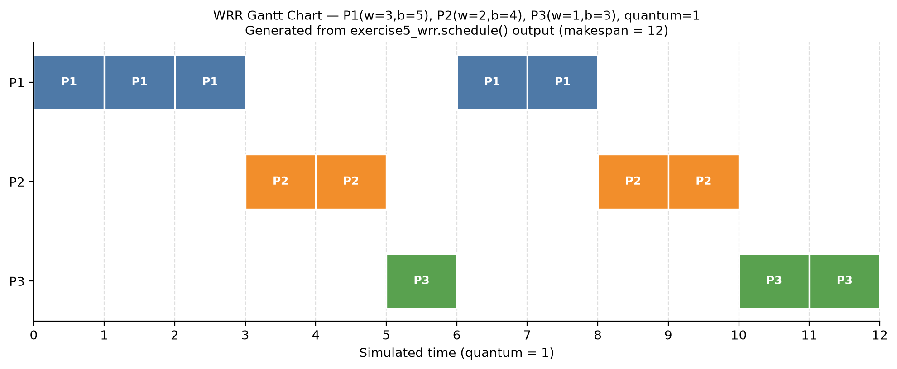
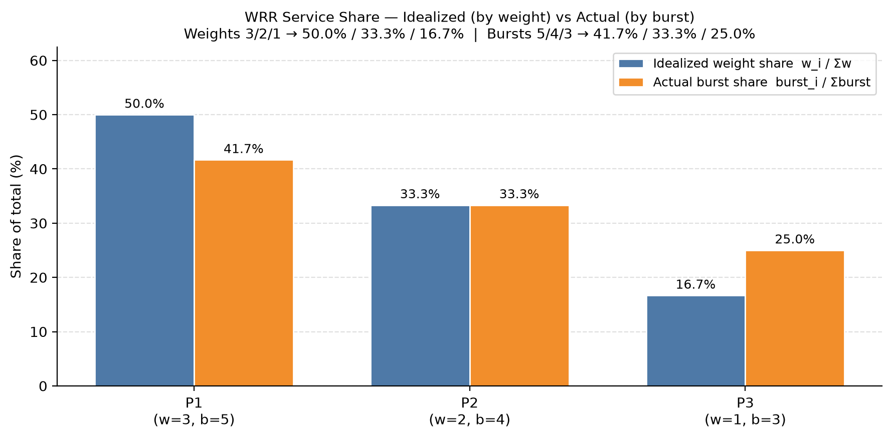

# WRR Process Scheduler

A Python-based **Weighted Round Robin (WRR)** process scheduler that launches external programs and allocates execution time according to user-defined weights.

> **Important scope note:** This project implements a weighted time-slicing experiment. It does not currently implement Earliest Deadline First (EDF) or Rate Monotonic (RM), and it does not model task periods or deadlines. The EDF/RM section below is therefore an algorithm-level comparison, not a claim that this code has benchmarked those schedulers.

## Overview

The script in [`WRR.py`](./WRR.py) asks for:
- The number of programs to schedule
- A time quantum, in seconds
- The executable path and positive integer weight for each program

The scheduler starts the programs, suspends them, and then cycles through the process list. During each visit, it gives a process up to `weight` execution slices, each bounded by the configured quantum. A process that finishes is skipped in later turns.

## How WRR works in this project

1. Read the process count and time quantum.
2. Read each executable path and its positive integer weight.
3. Launch each program and suspend it initially.
4. Visit processes in input order.
5. For each unfinished process, resume it for up to `weight` slices of length `quantum`.
6. Suspend it between slices when it has not exited.
7. Continue until all processes finish, then print CPU time, elapsed runtime, and return code.

### Allocation intuition

For continuously runnable processes, the idealized share associated with a process is approximately:

\[
\text{share}_i = \frac{w_i}{\sum_j w_j}\times 100\%
\]

For weights `P1=3`, `P2=2`, and `P3=1`, the idealized proportions are 50%, 33.3%, and 16.7%. These are **weight-based expectations**, not guaranteed measured results: process completion, operating-system scheduling, blocking, and timing overhead can change actual measurements.

## Gantt chart (from deterministic simulation)

The chart below is generated from the **actual output of `exercise5_wrr.schedule()`**
(workload `P1(w=3,b=5), P2(w=2,b=4), P3(w=1,b=3)`, `quantum=1`, makespan `12`).
It shows the weighted dispatch order produced by the simulation code.
It is **not** a benchmark captured from running external OS processes with `WRR.py`.



*Figure 1 — Gantt chart generated by `tools_generate_figures.py` from real `schedule()` segments. Each block is one quantum. P1 runs 3 quanta, then P2 runs 2, then P3 runs 1 in the first round.*

## Expected allocation by weight



*Figure 2 — Idealized weight share (`w_i / Σw`) vs actual burst share (`burst_i / Σburst`) for the same workload. The difference shows why weight proportions are expectations, not guarantees, when bursts are finite.*

## WRR vs. EDF vs. RM

These algorithms answer different scheduling questions:

| Property | WRR (this project) | EDF | RM |
|---|---|---|---|
| Main selection rule | Weighted turns / time slices | Task with the earliest absolute deadline | Fixed priority based on task period (shorter period = higher priority) |
| Priority type | Weight-based service allocation | Dynamic | Fixed |
| Requires task periods? | No | Usually yes for periodic-task evaluation | Yes |
| Requires deadlines? | No | Yes | Deadlines are evaluated; classic RM assumes deadline equals period for its standard guarantee |
| Primary goal | Share CPU service according to weights | Meet deadlines using deadline urgency | Meet periodic real-time deadlines using fixed priorities |
| What this implementation measures | CPU time, elapsed runtime, return code | Not implemented here | Not implemented here |

### Strengths and limitations

- **WRR:** simple and useful when different processes should receive different proportions of service. A larger weight grants more consecutive time slices per visit in this implementation.
- **EDF:** adapts priorities as deadlines approach and is optimal among single-processor, preemptive schedulers under the classic independent-task assumptions. This project does not currently calculate deadlines or select tasks by deadline.
- **RM:** provides static, predictable priorities for periodic real-time tasks. This project does not currently assign priorities from task periods.

**Fair comparison warning:** a numerical performance ranking cannot be concluded from this repository alone. A valid experiment would need the same task set, execution times, periods/deadlines, preemption assumptions, and metrics implemented for all three algorithms. WRR weights are not equivalent to EDF deadlines or RM periods.

## Requirements

- Python 3.8+ (recommended)
- `psutil`

Install the dependency:

```bash
python -m pip install psutil
```

## Run

Clone the repository and enter its directory:

```bash
git clone https://github.com/Mmdvahedi2005/WRR.git
cd WRR
python -m pip install psutil
python WRR.py
```

Then follow the prompts. For each program, provide an executable path and a positive integer weight. The program being launched must be executable on your operating system and must not require interactive input unless you have adapted the script for that use.

### Example input

```text
Number of programs: 3
Time quantum (seconds): 1
Program 1 path: /path/to/program1
Program 1 weight: 3
Program 2 path: /path/to/program2
Program 2 weight: 2
Program 3 path: /path/to/program3
Program 3 weight: 1
```

Replace the example paths with real executable paths on your machine. On Windows, use the appropriate `.exe` path and ensure the command can be launched directly by `subprocess.Popen`.

## Output

At the end, the script prints a table with:
- **Weight** — configured weight for the process
- **CPU Time** — CPU time accumulated while the scheduler samples the process
- **Runtime** — elapsed time measured from the process start
- **Return Code** — exit status reported by the operating system

## Implementation notes

- The implementation relies on `psutil.Process.suspend()` and `resume()`, so process-control permissions and operating-system behavior matter.
- The current code uses a per-process `wait(timeout=quantum)` loop. A timeout is a scheduling slice limit, not a hard real-time guarantee.
- The scheduler visits processes in the order entered by the user.
- The script currently launches executable paths directly; it does not parse arbitrary shell commands with arguments.
- This is an educational user-space scheduler, not a replacement for the operating system's kernel scheduler and not a hard real-time scheduler.

## Project structure

```text
WRR/
├── README.md                      # This file (base WRR project)
├── PROJECT_INDEX.md               # Index of all 7 exercises and their branches
├── PROJECT_PROGRESS.md            # Upgrade status and remaining work
├── WRR.py                         # Interactive OS-process WRR scheduler (psutil)
├── exercise5_wrr.py               # Exercise 5: deterministic WRR simulation + sync variants
├── test_exercise5_wrr.py          # Unit tests for Exercise 5 (9 tests)
├── README_Exercise5_WRR.md        # Exercise 5 overview (see also Exercise-5-WRR branch)
├── SAMPLE_RUN_Exercise5_WRR.txt   # Verified sample output
├── TEST_RESULTS_Exercise5_WRR.txt # Verified test report
├── tools_generate_figures.py      # Regenerates docs/figures/*.png from real schedule() output
├── requirements.txt               # Python dependencies
├── assets/
│   └── wrr_sync_comparison.svg    # Sync-variant comparison diagram
├── docs/
│   ├── README.md                  # Documentation guide
│   ├── figures/                   # Generated figures (PNG/SVG)
│   ├── reports/                   # Academic reports (FA/EN)
│   └── references/                # References
└── outputs/                       # Generated Gantt SVGs from exercise5 runs
```

## Documentation

- **Project index (all exercises):** [PROJECT_INDEX.md](./PROJECT_INDEX.md)
- **Documentation guide:** [docs/README.md](./docs/README.md)
- **Exercise 5 overview:** [README_Exercise5_WRR.md](./README_Exercise5_WRR.md)
- **Exercise 5 full docs:** branch `Exercise-5-WRR` → `docs/README.md`

## Conclusion

This repository contains two complementary WRR implementations: `WRR.py` for
experimenting with real OS processes via `suspend()`/`resume()`, and
`exercise5_wrr.py` for deterministic, reproducible simulation with
Semaphore/Monitor synchronization variants. The figures above are generated
directly from the simulation code so that documentation and implementation
stay consistent. See [PROJECT_INDEX.md](./PROJECT_INDEX.md) for the status
of all seven exercises.

## Future improvements

- Add input validation and clearer handling for invalid executable paths.
- Add command-line arguments and support for executable arguments.
- Record each dispatch event and generate a Gantt chart from actual execution logs.
- Implement EDF and RM as separate scheduling policies using an explicitly defined periodic task set.
- Add repeatable benchmark runs and compare deadline misses, response time, waiting time, CPU utilization, and overhead.

## Author

**Mmdvahedi2005**

Repository: https://github.com/Mmdvahedi2005/WRR
