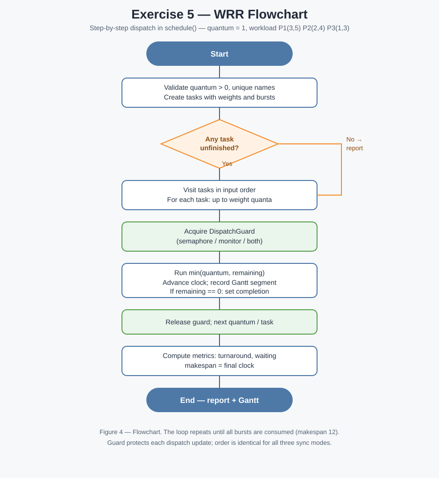
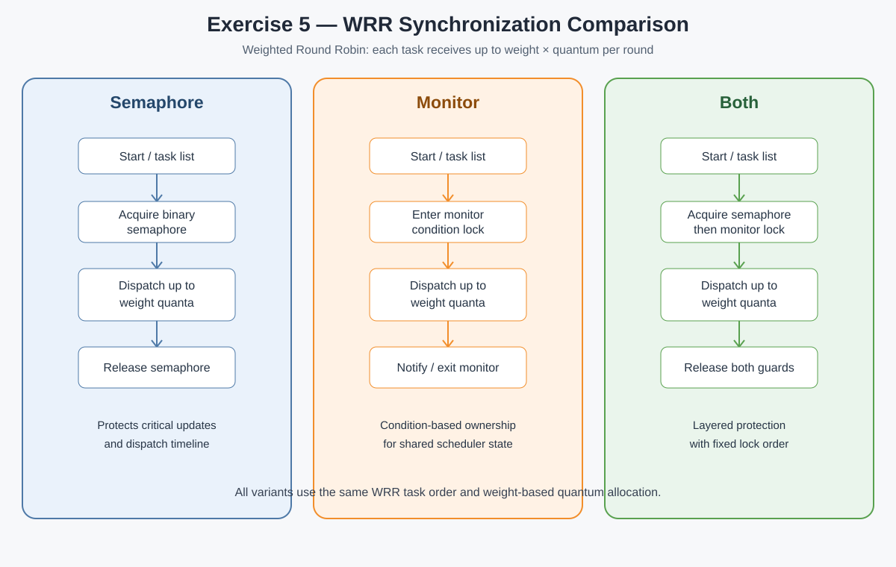
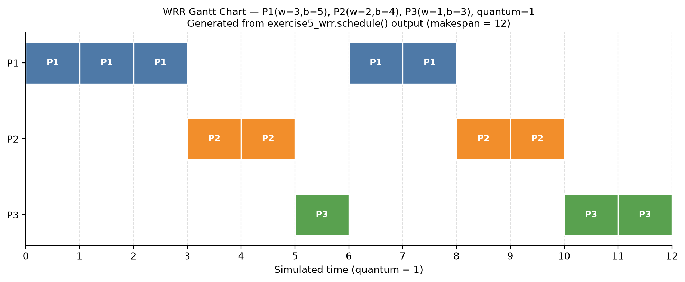
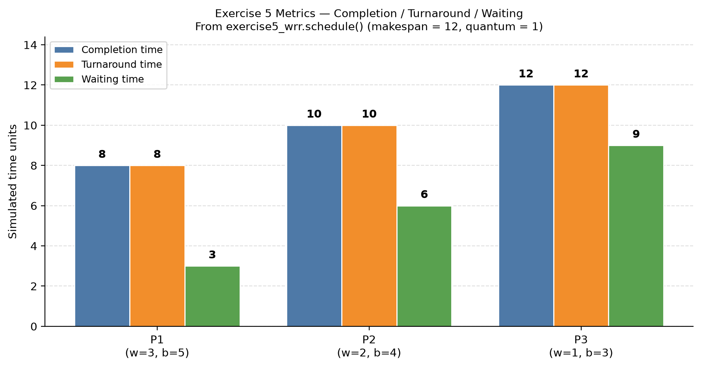
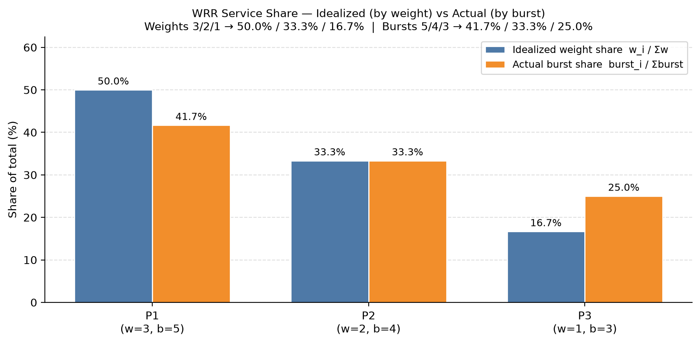

# Exercise 5 — Weighted Round Robin (WRR) with Synchronization

> Branch: `Exercise-5-WRR` · Full guide: [docs/README.md](./docs/README.md) ·
> Reports: [report_en.md](./docs/reports/report_en.md) · [report_fa.md](./docs/reports/report_fa.md)

This exercise adapts the repository's Weighted Round Robin idea to compare
three synchronization designs: **Semaphore**, **Monitor**, and
**Semaphore + Monitor (Both)** — on identical, deterministic workloads.

## 1. Introduction

**Problem.** Plain Round Robin gives every runnable process the same service.
When processes should receive *different* shares of CPU, a weight is needed.
WRR grants each process up to `weight` consecutive quanta per round, so
heavier processes progress faster while the dispatch order stays simple
and predictable.

**Goal of this exercise.** Implement WRR as a deterministic simulation,
protect each dispatch update with a synchronization guard, and verify that
all three guard designs produce the *same* schedule and metrics.

**Application.** Weighted service allocation in schedulers, load balancers,
and network packet scheduling where proportional fairness matters more than
deadline urgency (unlike EDF/RM, which are not implemented here).

## 2. Scheduling policy

Each runnable task receives up to `weight` quanta in each round. A final
quantum is shortened to the remaining CPU burst. Finished tasks are skipped.
For continuously runnable tasks, the idealized service proportion is:

```text
share(i) = weight(i) / sum(weights) * 100%
```

Weights determine the number of quanta per visit; they are not deadlines
or fixed priorities.

## 3. Architecture


*Figure 1 — Architecture of `exercise5_wrr.py`. The CLI creates `Task`
objects, `schedule()` dispatches them under a `DispatchGuard`, and
`gantt_svg()` renders the result. Tests verify the whole pipeline.*

## 4. Flowchart



*Figure 2 — Step-by-step dispatch loop. The guard is acquired for every
quantum update and released immediately after, keeping the simulation
deterministic.*

## 5. Synchronization variants

- **Semaphore:** a binary semaphore protects each dispatch/update critical section.
- **Monitor:** a condition-based monitor protects the same shared scheduler state.
- **Both:** both mechanisms are acquired in a fixed order (semaphore, then monitor) to demonstrate combined protection.



*Figure 3 — The three guard designs. All protect the same critical section;
only the mechanism differs.*

The scheduler is deliberately deterministic and single-dispatcher so all
three variants can be compared on identical workloads. The guards illustrate
safe critical-section ownership; they do not claim a speedup from parallel
execution.

## 6. Results (verified)

Default workload: `P1(weight=3, burst=5)`, `P2(weight=2, burst=4)`,
`P3(weight=1, burst=3)`, `quantum=1`.



*Figure 4 — Gantt chart from real `schedule()` output (makespan 12).
Round 1: P1×3, P2×2, P3×1. P1 completes at 8, P2 at 10, P3 at 12.*



*Figure 5 — Completion, turnaround, and waiting times from real output.
All three sync modes give identical values (verified by tests).*



*Figure 6 — Idealized weight share vs actual burst share. The gap shows
why weight proportions are expectations with finite bursts.*

### Metrics definitions

- Completion time: simulated time at task completion.
- Turnaround time: completion minus arrival (all tasks arrive at time zero).
- Waiting time: turnaround minus CPU burst.
- Makespan: total simulated CPU timeline.

### Verified output

```text
SEMAPHORE | makespan=12
P1 {'weight': 3, 'burst': 5, 'completion': 8, 'turnaround': 8, 'waiting': 3}
P2 {'weight': 2, 'burst': 4, 'completion': 10, 'turnaround': 10, 'waiting': 6}
P3 {'weight': 1, 'burst': 3, 'completion': 12, 'turnaround': 12, 'waiting': 9}
```

## 7. How to run

### Prerequisites

- Python 3.8+ (recommended 3.10+)
- No third-party packages required for Exercise 5
  (`psutil` and `matplotlib` are only needed for `WRR.py` and figure regeneration)

### Install

```bash
python -m pip install -r requirements.txt
```

### Run the simulation

```bash
python exercise5_wrr.py --mode all --quantum 1
python exercise5_wrr.py --mode semaphore --quantum 1
python exercise5_wrr.py --mode monitor --quantum 1
python exercise5_wrr.py --mode both --quantum 1
```

Each run writes one SVG Gantt chart per mode (default prefix `wrr-gantt`).
To archive outputs in `outputs/`:

```bash
python exercise5_wrr.py --mode all --quantum 1 --gantt outputs/wrr-gantt
```

### Sample input / output

There is no interactive input: the workload is fixed in `main()`
(`P1(3,5), P2(2,4), P3(1,3)`). The output is the metrics table above plus
three SVG files: `wrr-gantt-semaphore.svg`, `wrr-gantt-monitor.svg`,
`wrr-gantt-both.svg`.

### Run tests

```bash
python -m unittest -v
```

Expected: **9 tests, all passing** (see `TEST_RESULTS_Exercise5_WRR.txt`).

### Regenerate figures

```bash
python tools_generate_figures.py
python tools_generate_exercise5_figures.py
```

Both scripts read real `schedule()` output — no hardcoded results.

## 8. Project structure

```text
Exercise-5-WRR/
├── README_Exercise5_WRR.md        # This file
├── exercise5_wrr.py               # Simulation (Task, DispatchGuard, schedule)
├── test_exercise5_wrr.py          # 9 unit tests
├── SAMPLE_RUN_Exercise5_WRR.txt   # Verified sample output
├── TEST_RESULTS_Exercise5_WRR.txt # Verified test report
├── tools_generate_figures.py      # Gantt + share figures from real output
├── tools_generate_exercise5_figures.py  # Metrics figure from real output
├── requirements.txt
├── assets/
│   └── wrr_sync_comparison.svg
├── docs/
│   ├── README.md                  # Full documentation guide
│   ├── figures/
│   │   ├── architecture.svg
│   │   ├── flowchart.svg
│   │   ├── wrr_gantt.png
│   │   ├── wrr_metrics.png
│   │   ├── wrr_cpu_share.png
│   │   └── wrr_sync_comparison.svg
│   ├── reports/
│   │   ├── report_en.md
│   │   └── report_fa.md
│   └── references/
│       └── README.md
└── outputs/
    ├── wrr-gantt-semaphore.svg
    ├── wrr-gantt-monitor.svg
    └── wrr-gantt-both.svg
```

## 9. Test coverage

The tests cover weighted dispatch order, equivalence across synchronization
modes, completion metrics, shortened final quanta, zero bursts, and invalid
inputs (quantum, weight, duplicate names, mode).

## 10. Scope, limitations, and conclusion

This is an educational scheduler simulation. It models CPU bursts as
deterministic work units, not operating-system processes. It does not
suspend/resume external programs or measure real CPU time. The
synchronization implementations serialize shared scheduler updates, allowing
algorithmic results to remain deterministic and comparable.

**Conclusion.** WRR allocates service proportionally to weights with a
simple, reproducible dispatch order. The three synchronization variants
produce identical schedules by design, demonstrating correct
critical-section ownership without claiming parallel speedup. See
[docs/README.md](./docs/README.md) for the full guide and figure-reading
notes.
