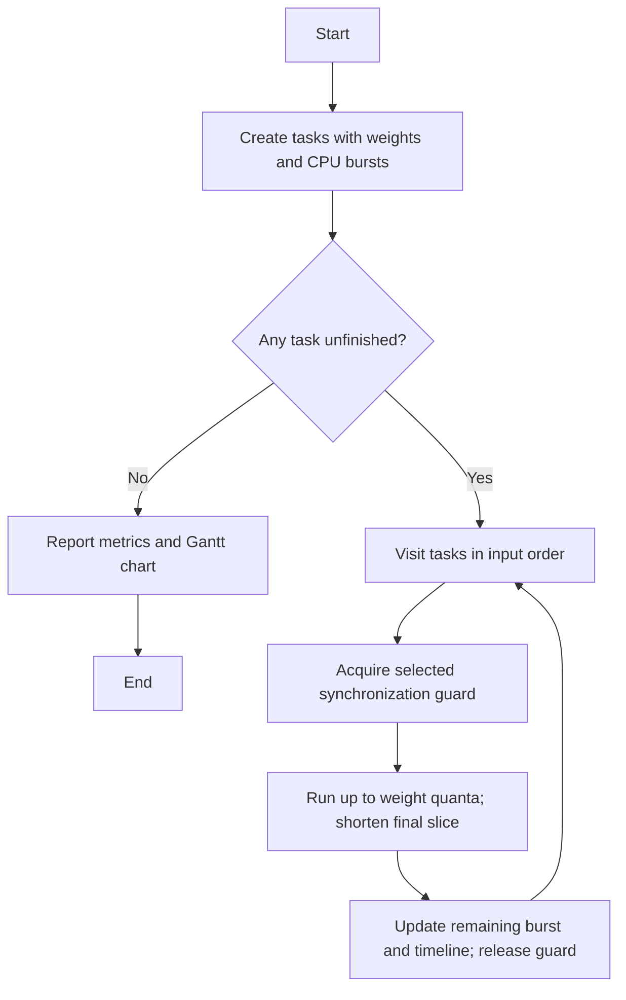

# Exercise 5 — Weighted Round Robin (WRR) with Synchronization

This exercise adapts the repository's Weighted Round Robin idea to compare three synchronization designs: **Semaphore**, **Monitor**, and **Semaphore + Monitor**.

## Scheduling policy

Each runnable task receives up to `weight` quanta in each round. A final quantum is shortened to the remaining CPU burst. Finished tasks are skipped. For continuously runnable tasks, the idealized service proportion is approximately:

`share(i) = weight(i) / sum(weights) * 100%`

Weights determine the number of quanta per visit; they are not deadlines or fixed priorities.

## Synchronization variants

- **Semaphore:** a binary semaphore protects each dispatch/update critical section.
- **Monitor:** a condition-based monitor protects the same shared scheduler state.
- **Both:** both mechanisms are acquired in a fixed order (semaphore, then monitor) to demonstrate combined protection.

The scheduler is deliberately deterministic and single-dispatcher so all three variants can be compared on identical workloads. The guards illustrate safe critical-section ownership; they do not claim a speedup from parallel execution.

## Flowchart



## Run

```bash
python exercise5_wrr.py --mode all --quantum 1
python -m unittest -v
```

The demo writes one SVG Gantt chart per mode. The default workload is P1(weight=3, burst=5), P2(weight=2, burst=4), P3(weight=1, burst=3).

## Metrics

- Completion time: simulated time at task completion.
- Turnaround time: completion minus arrival (all tasks arrive at time zero).
- Waiting time: turnaround minus CPU burst.
- Makespan: total simulated CPU timeline.

## Test coverage

The tests cover weighted dispatch order, equivalence across synchronization modes, completion metrics, shortened final quanta, zero bursts, and invalid inputs.

## Scope and assumptions

This is an educational scheduler simulation. It models CPU bursts as deterministic work units, not operating-system processes. It does not suspend/resume external programs or measure real CPU time. The synchronization implementations serialize shared scheduler updates, allowing algorithmic results to remain deterministic and comparable.
