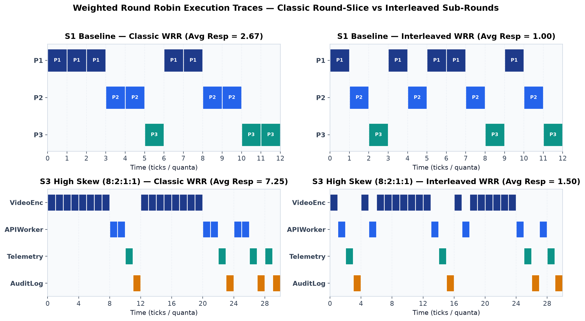
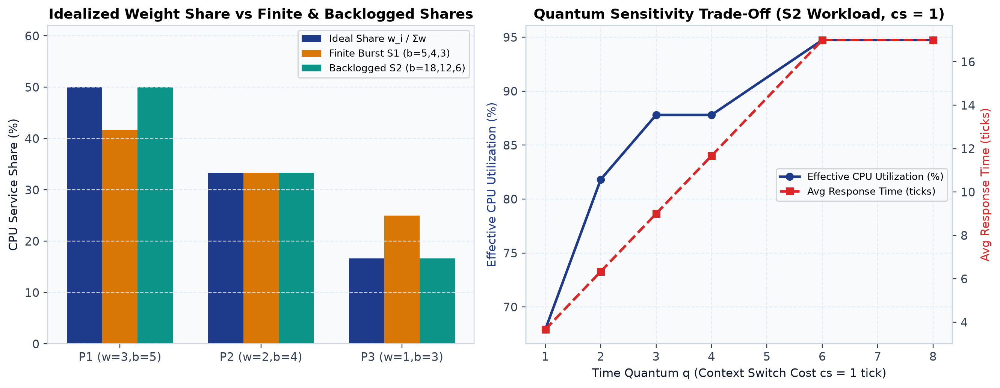

# Exercise 1 — Complete Introduction to Weighted Round Robin (WRR)

**Algorithm Introduction, Flowchart, Pseudocode, Figures, and Full Explanations**

- **Course:** Operating Systems
- **Exercise:** 1 — WRR Algorithm Introduction
- **Branch:** Exercise-1-WRR
- **Language:** English / Persian (Bilingual)
- **Implementation:** Python (wrr_scheduler.py)
- **Figures:** 2 SVG structural + 3 PNG data-driven
- **Tests:** 10 unit tests — all passing

---

## Table of Contents

1. 1. Introduction & Problem Statement
2. 2. Algorithm Description
3. 3. Implementation & Tests
4. 4. Results & Figures
5. 5. Conclusion

---

## 1. 1. Introduction & Problem Statement

Weighted Round Robin (WRR) is a preemptive CPU scheduling algorithm where each process receives up to its assigned weight number of quanta per round. Unlike Classical Round Robin which treats all processes equally, WRR allocates CPU time proportional to each process's defined weight, enabling weighted fairness.

- Each process receives w_i quanta per round
- Suitable for services with different priority levels
- Weighted fairness proportional to assigned weights
- Simple and deterministic implementation

## 2. 2. Algorithm Description

In Classical WRR, scheduling occurs in rounds. In each round, processes are visited in order and each runs for up to min(weight, remaining_burst) quanta. In Interleaved WRR, each round is divided into sub-rounds so that low-weight processes receive service earlier, reducing average response time.

- Classical WRR: block quanta per round
- Interleaved WRR: distributed sub-rounds
- Lower avg response time in interleaved mode

## 3. 3. Implementation & Tests

- wrr_scheduler.py: WRRScheduler class with classic & interleaved modes
- test_wrr_scheduler.py: 10 unit tests
- Scenarios S1–S4: baseline, backlogged, high skew, dynamic arrivals

## 4. 4. Results & Figures

*Figure 1 — Figure 1 — WRR Flowchart: Round-Slice vs Interleaved scheduling logic*

*Figure 2 — Figure 2 — Gantt traces S1 & S3: Classic vs Interleaved WRR*

*Figure 3 — Figure 3 — Throughput vs latency trade-off in WRR*

**Table 1 — Table 1 — WRR scenario results (from wrr_scheduler.py)**

| Scenario | Mode | Makespan | Avg Wait | Avg Resp | Jain |
| --- | --- | --- | --- | --- | --- |
| S1 Baseline | Classic | 12 | 6.0 | 2.67 | 0.990 |
| S1 Baseline | Interleaved | 12 | 7.0 | 1.00 | 0.968 |
| S2 Backlogged | Classic | 36 | 22.67 | 2.67 | 0.999 |
| S2 Backlogged | Interleaved | 36 | 22.67 | 1.00 | 0.999 |
| S3 High Skew | Classic | 30 | — | 7.25 | — |
| S3 High Skew | Interleaved | 30 | — | 1.50 | — |

## 5. 5. Conclusion

WRR provides weighted CPU allocation proportional to assigned weights. The interleaved variant reduces response time for low-weight processes without affecting overall throughput.
