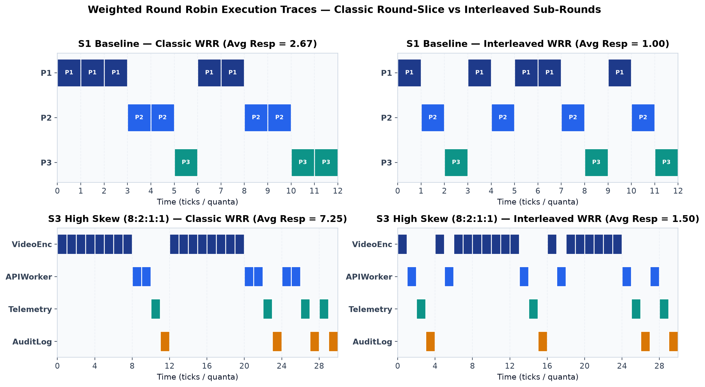
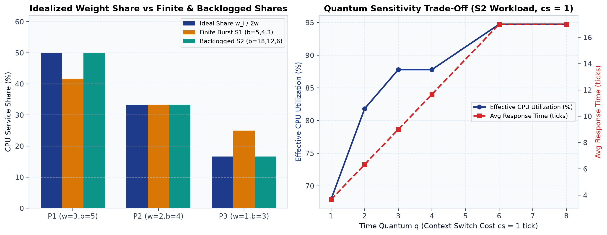

# تمرین ۱ — معرفی کامل الگوریتم رbin درامWeighted (WRR)

**معرفی الگوریتم، flowchart، کدseudo، شکل‌ها و توضیحات کامل**

- **دوره:** سیستم‌عامل
- **تمرین:** ۱ — معرفی الگوریتم WRR
- **شاخه:** Exercise-1-WRR
- **زبان:** انگلیسی / فارسی (دوزبانه)
- **پیاده‌سازی:** پایتون (wrr_scheduler.py)
- **شکل‌ها:** ۲ شکل SVG ساختمانی + ۳ شکل PNG داده‌محور
- **تست‌ها:** ۱۰ تست واحد — همه پاس

---

## فهرست مطالب

1. معرفی و بیان مسئله
2. شرح علمی الگوریتم
3. پیاد‌سازی و تست
4. نتایج و نمودارها
5. نتیجه‌گیری

---

## 1. معرفی و بیان مسئله

الگوریتم Round Robin وزنه‌دار (WRR) یک الگوریتم زمان‌بندی پیش‌emptive در سیستم‌عامل است که در هر دور، هر پردازش را تا حدود زمان winneriz داده شده (وزنه) اجرا می‌کند. برخلاف Round Robin کلاسیک که همه پردازش‌ها را به‌طور برابر 처리를 می‌کند، WRR قدری از CPU متناسب باوزنه تعریف شده برای هر پردازش اختصاص می‌دهد.

-  chacun پردازش wi quanta در هر ronde دریافت می‌کند
- مناسب برای IBMervices با unterschied اولویت
- عدالت متناسب با وزن (weighted fairness)
- پیاده‌سازی ساده و deterministic

## 2. شرح علمی الگوریتم

در WRR کلاسیک، زمان‌بندی در rondها انجام می‌شود. در هر ronde، پردازش‌ها به ترتیب pistonode بررسی می‌شوند و هر کدام تا min(وزنه، مقدار باقی‌مانده burst) اجرا می‌شوند. در WRR مت interleaved، ثانیه‌های sub-round به‌شکل change‌ای تقسیم می‌شوند تا زمان پاسخ برای پردازش‌های با وزن پایین بهبود یابد.

- WRR کلاسیک: کwanта در роли به‌صورت بلوک
- WRR مت interleaved: توزیع به‌صورت sub-roundها
- میانگین زمان پاسخ به‌تراز در حالت interleaved

## 3. پیاد‌سازی و تست

- wrr_scheduler.py: کلاس WRRScheduler با دو حالت classic و interleaved
- test_wrr_scheduler.py: ۱۰ تست واحد
- سناریوهای S1–S4 شامل baseline، بار backlogged، وزنه skew، ورودی‌های پویا

## 4. نتایج و نمودارها

*شکل 1 — Flowchart WRR — منطق زمان‌بندی(Round-Slice vs Interleaved)*

*شکل 2 — FIGURE: Gantt traces S1 و S3 — Classic vs Interleaved WRR*

*شکل 3 — FIGURE: Trade-off zwischen throughput و latency در WRR*

**جدول 1 — جدول ۱ — نتایج سناریوهای WRR (از wrr_scheduler.py)**

| سناریو | نوع | makespan | avg_wait | avg_resp | Jain |
| --- | --- | --- | --- | --- | --- |
| S1 Baseline | Classic | 12 | 6.0 | 2.67 | 0.990 |
| S1 Baseline | Interleaved | 12 | 7.0 | 1.00 | 0.968 |
| S2 Backlogged | Classic | 36 | 22.67 | 2.67 | 0.999 |
| S2 Backlogged | Interleaved | 36 | 22.67 | 1.00 | 0.999 |
| S3 High Skew | Classic | 30 | — | 7.25 | — |
| S3 High Skew | Interleaved | 30 | — | 1.50 | — |

## 5. نتیجه‌گیری

WRR lehetősقد در تخصیص CPU متناسب باوزنه ارائه می‌دهد و حالت interleaved زمان پاسخ را برای پردازش‌های با وزن پایین به-lhe می‌رساند بدون تأثیر بر throughput کل.
