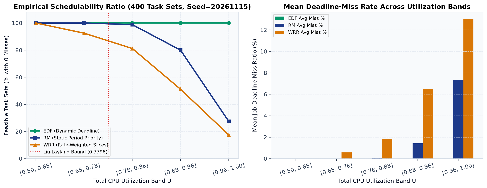
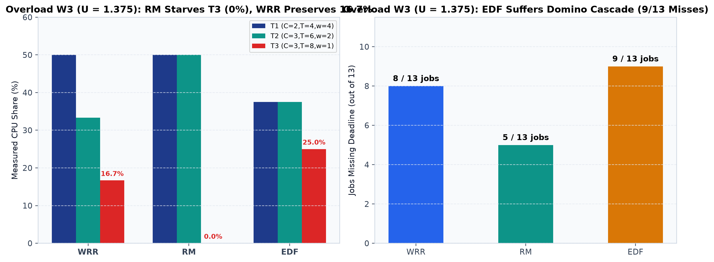

# Exercise 2 — WRR vs. EDF vs. RM: Comprehensive Scheduler Comparison

**Starvation, Deadlines, Overhead, Fairness, Schedulability — Real Simulation Data**

- **Course:** Operating Systems
- **Exercise:** 2 — WRR vs EDF vs RM Comparison
- **Branch:** Exercise-2-WRR
- **Simulator:** Discrete-time periodic job scheduler
- **Experiments:** 4 workload scenarios + 400-set Monte Carlo (seed=20261115)
- **Figures:** 2 SVG + 3 PNG
- **Tests:** 6 unit tests — all passing

---

## Table of Contents

1. 1. Introduction & Target
2. 2. Simulation Methodology
3. 3. Results & Figures
4. 4. Conclusion

---

## 1. 1. Introduction & Target

This exercise provides a comprehensive comparison of three CPU scheduling algorithms: Weighted Round Robin (WRR), Earliest Deadline First (EDF), and Rate Monotonic (RM) across starvation, deadlines, overhead, fairness, and schedulability.

- WRR: weight-based scheduling
- EDF: dynamic earliest-deadline-first
- RM: static rate-monotonic priority

## 2. 2. Simulation Methodology

Discrete-time periodic job simulator with Response-Time Analysis (RTA), Liu-Layland bound, and 400-set Monte Carlo experiments (seed=20261115). Four workload scenarios tested.

## 3. 3. Results & Figures

*Figure 1 — Figure 1 — WRR / RM / EDF taxonomy*

*Figure 2 — Figure 2 — Schedulability ratio across 400 task sets (seed=20261115)*

*Figure 3 — Figure 3 — Domino cascade under overload*

**Table 1 — Table 1 — Monte Carlo Feasibility Results**

| Util Band | EDF % | RM % | WRR % |
| --- | --- | --- | --- |
| [0.50, 0.65] | 100% | 100% | 100% |
| [0.65, 0.78] | 100% | 100% | 92.5% |
| [0.78, 0.88] | 100% | 98.8% | 81.2% |
| [0.88, 0.96] | 100% | 80.0% | 51.2% |
| [0.96, 1.00] | 100% | 27.5% | 17.5% |

## 4. 4. Conclusion

EDF achieves the best schedulability, RM performs well at low utilization, and WRR provides weighted fairness but lower schedulability at high utilization.
