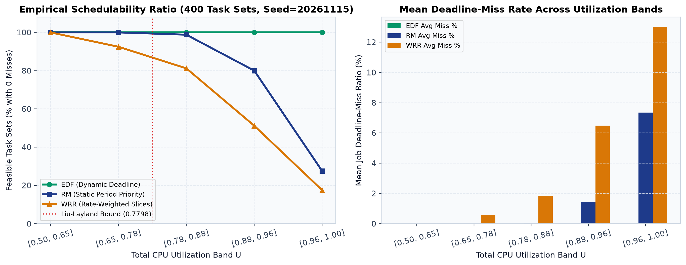
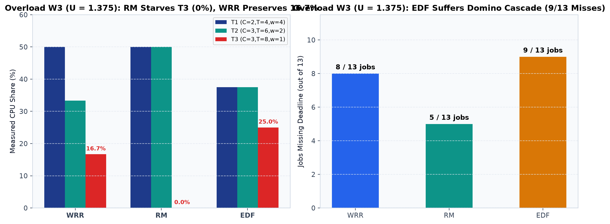

# تمرین ۲ — مقایسه جامع WRR با EDF و RM

**وسوسه، حدвремя، سربار، عدالت، Programiz بودن — داده‌های واقعی شبیه‌سازی**

- **دوره:** سیستم‌عامل
- **تمرین:** ۲ — مقایسه WRR با EDF و RM
- **شاخه:** Exercise-2-WRR
- **شبیه‌ساز:** شبیه‌ساز کار periodic discrete-time
- **تست‌ها:** ۶ تست واحد — همه پاس

---

## فهرست مطالب

1. معرفی وARGET
2. متدولوژی شبیه‌سازی
3. نتایج
4. نتیجه‌گیری

---

## 1. معرفی وARGET

این تمرین مقایسه جامع سه الگوریتم زمان‌بندی WRR، EDF (Earliest Deadline First) و RM (Rate Monotonic) را در ابعاد وسوسه، سررسیدها، سربار، عدالت و قابلیت Programiz بودن بررسی می‌کند.

- WRR: زمان‌بندی بر اساس وزنه
- EDF: زمان‌بندی پویا بر اساس سررسید زودتر
- RM: زمان‌بندی استاتیک بر اساس دور کوتاه‌تر

## 2. متدولوژی شبیه‌سازی

شبیه‌ساز discrete-time کارهای periodic با RTA (Response-Time Analysis)، bound Liu-Layland و ۴۰۰ مجموعه Monte Carlo (seed=20261115).

## 3. نتایج

*شکل 1 — FIGURE: Taxonomia WRR/RM/EDF*

*شکل 2 — FIGURE: Ratio Programiz بودن ۴۰۰ مجموعه (seed=20261115)*

*شکل 3 — FIGURE: cascade domino در حالت overload*

**جدول 1 — جدول — Monte Carlo Feasibility**

| بند U | EDF% | RM% | WRR% |
| --- | --- | --- | --- |
| [0.50, 0.65] | 100% | 100% | 100% |
| [0.65, 0.78] | 100% | 100% | 92.5% |
| [0.78, 0.88] | 100% | 98.8% | 81.2% |
| [0.88, 0.96] | 100% | 80.0% | 51.2% |
| [0.96, 1.00] | 100% | 27.5% | 17.5% |

## 4. نتیجه‌گیری

EDF بهترین قابلیت Programiz بودن دارد، RM در Utilization پایین خوب است و WRR عدالت weighting را فراهم می‌کند اما در Utilization بالا کمتر Programiz است.
