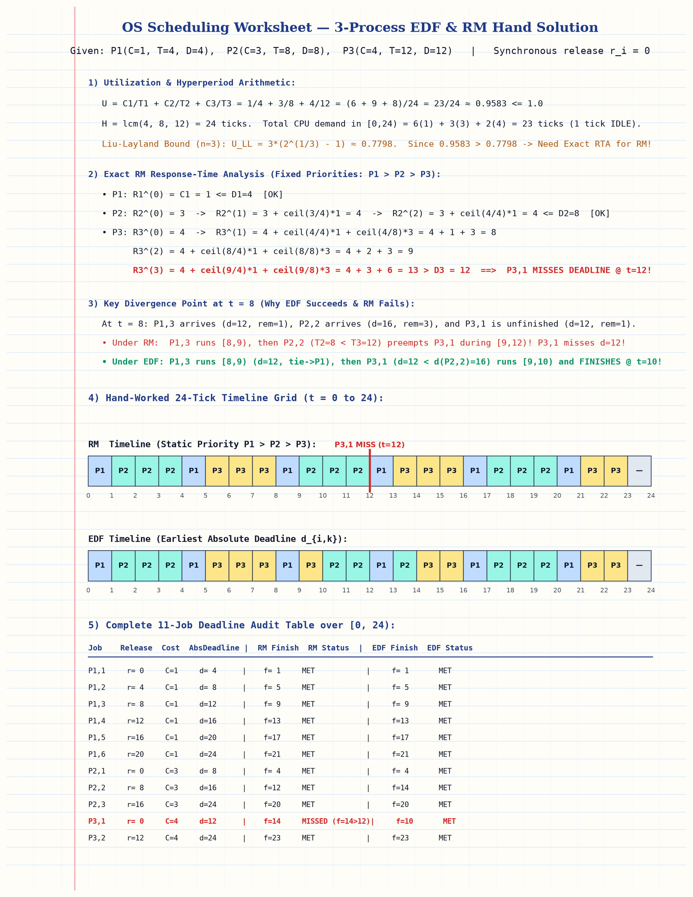

# Exercise 3 — Manual EDF & RM Scheduling: 3-Process Case Studies

**Case A (H=12) and Case B (H=24) — Hyperperiod Tables, RTA Traces, Deadline Audit**

- **Course:** Operating Systems
- **Exercise:** 3 — Manual EDF & RM Scheduling
- **Branch:** Exercise-3-WRR
- **Case A:** P1(C=1,T=4), P2(C=2,T=6), P3(C=4,T=12), U=0.9167 > LL=0.7798
- **Case B:** P1(C=1,T=4), P2(C=3,T=8), P3(C=4,T=12), U=0.9583
- **Finding:** RM misses P3,1 at t=12; EDF meets all 11/11 deadlines
- **Figures:** 2 SVG + 3 PNG (incl. hand-worked worksheet)
- **Tests:** 3 unit tests — all passing

---

## Table of Contents

1. 1. Introduction
2. 2. Response-Time Analysis (RTA)
3. 3. Figures & Worksheet
4. 4. Conclusion

---

## 1. 1. Introduction

Manual EDF and RM scheduling with 3 processes across two cases: Case A (H=12) and Case B (H=24).

- Case A: P1(C=1,T=4), P2(C=2,T=6), P3(C=4,T=12), U=11/12=0.9167 > LL=0.7798
- Case B: P1(C=1,T=4), P2(C=3,T=8), P3(C=4,T=12), U=23/24=0.9583

## 2. 2. Response-Time Analysis (RTA)

In Case B, RTA for P3 diverges: [4, 8, 9, 13] > D=12, showing RM failure. EDF meets all deadlines because at t=9, d(P3,1)=12 < d(P2,2)=16.

## 3. 3. Figures & Worksheet

*Figure 1 — Figure 1 — Manual scheduling method flowchart*

*Figure 2 — Figure 2 — Hyperperiod lattice*

*Figure 3 — Figure 3 — Hand-worked 24-tick paper worksheet*

**Table 1 — Table 1 — P3 deadline audit in Case B**

| Job | Release | Cost | Deadline | RM Finish | RM Status | EDF Finish | EDF Status |
| --- | --- | --- | --- | --- | --- | --- | --- |
| P3,1 | r=0 | C=4 | d=12 | f=14 | MISSED | f=10 | MET |
| P3,2 | r=12 | C=4 | d=24 | f=23 | MET | f=23 | MET |

## 4. 4. Conclusion

RM misses P3,1 at t=12 in Case B; EDF meets all 11/11 deadlines.
