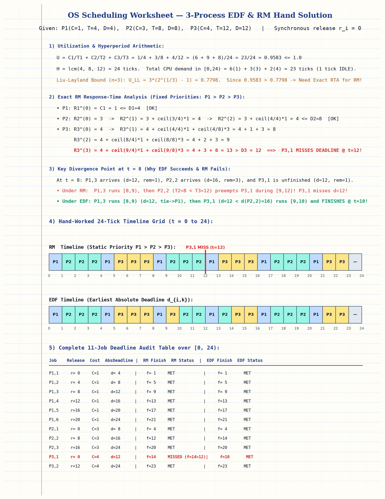

# تمرین ۳ — زمان‌بندی دستی EDF و RM: سه پردازش

**موارد A (H=12) و B (H=24) — جدول‌های hiperdurch، پیگیری RTA، بررسی سررسید**

- **دوره:** سیستم‌عامل
- **تمرین:** ۳ — زمان‌بندی دستی EDF و RM
- **شاخه:** Exercise-3-WRR
- **موارد:** میان-case A و B — وجدول‌های hiperdurch، پیگیری RTA، بررسی سررسید
- **发现ها:** RM سررسید P3,1 را در t=12 از دست می‌دهد؛ EDF همه ۱۱/۱۱ سررسیدها را برآورده می‌کند

---

## فهرست مطالب

1. معرفی
2. تحلیل زمان پاسخ (RTA)
3. شکل‌ها و جدول
4. نتیجه‌گیری

---

## 1. معرفی

زمان‌بندی دستی EDF و RM با سه پردازش در دو مورد: مورد A (H=۱۲) و مورد B (H=۲۴).

- مورد A: P1(C=1,T=4), P2(C=2,T=6), P3(C=4,T=12), U=۱۱/۱۲ > LL=۰.۷۷۹۸
- مورد B: P1(C=1,T=4), P2(C=3,T=8), P3(C=4,T=12), U=۲۳/۲۴

## 2. تحلیل زمان پاسخ (RTA)

در مورد B، RTA برای P3 विचّش می‌کند: [4, 8, 9, 13] > D=۱۲ که نشان می‌دهد RM شکست می‌خورد؛ در contrasted، EDF همه سررسیدها را برآورده می‌کند.

## 3. شکل‌ها و جدول

*شکل 1 — FIGURE: flowchart روش دستی*

*شکل 2 — FIGURE: لاستر hiperdurch*

*شکل 3 — FIGURE: worksheet کار ręczny ۲۴ تیک*

**جدول 1 — جدول — береج P3 در مورد B**

| Job | Release | Cost | Deadline | RM Finish | RM Status | EDF Finish | EDF Status |
| --- | --- | --- | --- | --- | --- | --- | --- |
| P3,1 | r=0 | C=4 | d=12 | f=14 | MISSED | f=10 | MET |
| P3,2 | r=12 | C=4 | d=24 | f=23 | MET | f=23 | MET |

## 4. نتیجه‌گیری

RM در مورد B سررسید P3,1 را در t=۱۲ از دست می‌دهد؛ EDF همه ۱۱/۱۱ سررسیدها را برآورده می‌کند.
