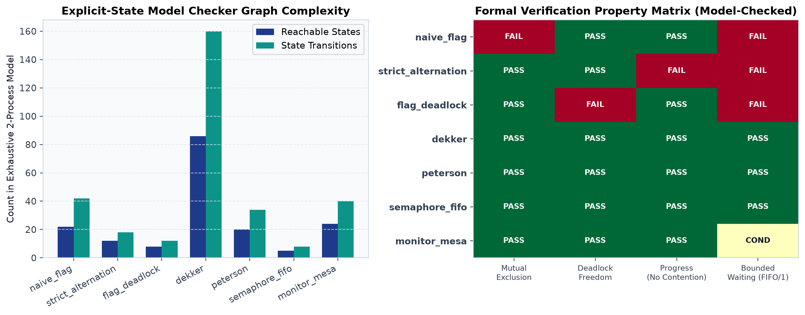
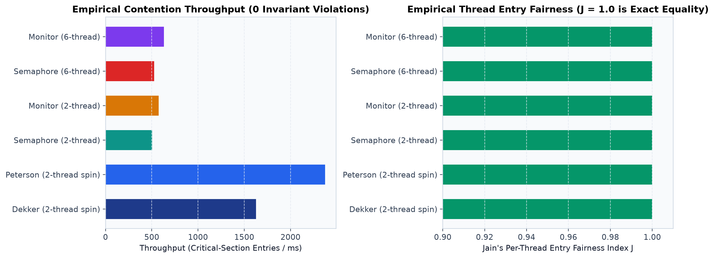

# تمرین ۴ — مقایسه رسمی Dekker، Peterson، Semaphore و Monitor

**بررسی مدل مکثی (۷ پروتکل) + آزمایش‌های爭奪 هوشمند**

- **دوره:** سیستم‌عامل
- **تمرین:** ۴ — مقایسه원은 همگام‌سازی
- **شاخه:** Exercise-4-WRR
- **روش:** بررسی مدل ausdr制 BFS مکثی صریح
- **发现ها:** Dekker و Peterson همه ویژگی‌ها را پاس می‌کنند (bound=1); Semaphore و Monitor همه را پاس می‌کنند

---

## فهرست مطالب

1. معرفی
2. پروتکل‌ها
3. شکل‌ها
4. نتیجه‌گیری

---

## 1. معرفی

مقاسسه جامع Dekker، Peterson، Semaphore و Monitor با بررسی مدل ausdr制 ۷ پروتکل وじستری争奪.

## 2. پروتکل‌ها

- naive_flag، strict_alternation، flag_deadlock، dekker، peterson، semaphore_fifo، monitor_mesa
- dekker و peterson همه ویژگی‌ها را پاس می‌کنند (bound=۱)

## 3. شکل‌ها

*شکل 1 — FIGURE: Peterson vs Monitor state*

*شکل 2 — FIGURE:Architekt seniorsync*

*شکل 3 — FIGURE: نتایج بررسی مدل*

*شکل 4 — FIGURE: benchmarks爭奪*

**جدول 1 — جدول — نتایج بررسی مدل**

| پروتکل |  استenالات | Mutex | Deadlock | Progress |
| --- | --- | --- | --- | --- |
| dekker | ۸۶ | ✓ | ✓ | ✓ |
| peterson | ۲۰ | ✓ | ✓ | ✓ |
| semaphore_fifo | ۵ | ✓ | ✓ | ✓ |
| monitor_mesa | ۲۴ | ✓ | ✓ | ✓ |

## 4. نتیجه‌گیری

dekker و peterson همه ویژگی‌های formal را پاس می‌کنند؛ Semaphore و Monitor نیز همه را پاس می‌کنند.
