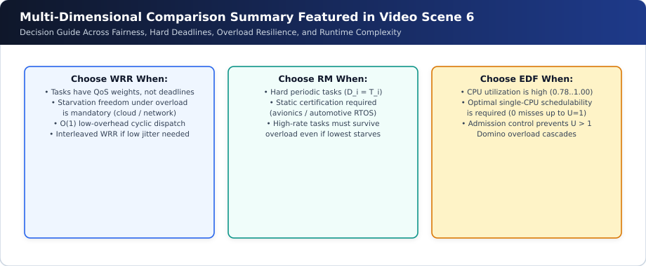
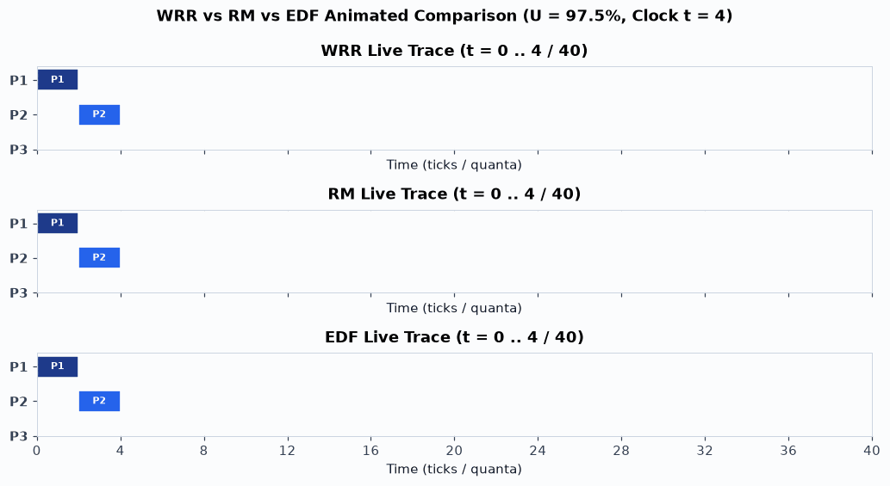

# Exercise 6 — Video Presentation: WRR vs EDF vs RM (>2 minutes)

**6 Scenes, 150s Storyboard, Animated GIF Demo, Keyframes, Narration Script**

- **Course:** Operating Systems
- **Exercise:** 6 — Video Presentation Package
- **Branch:** Exercise-6-WRR
- **Duration:** 150 seconds (02:30) — exceeds 2-minute requirement
- **Scenes:** 6 timed scenes: Intro → WRR → EDF → RM → Comparison → Conclusion
- **Artifacts:** wrr_vs_edf_rm_demo.gif, keyframe composite, storyboard SVG, narration script
- **Note:** Narration script provided as text; recorded voiceover requires external audio tooling
- **Tests:** 1 unit test — passing

---

## Table of Contents

1. 1. Introduction
2. 2. Artifacts
3. 3. Conclusion

---

## 1. 1. Introduction

Video presentation package comparing WRR vs EDF vs RM: 6 scenes, 150 seconds (02:30) — exceeds the 2-minute requirement.

- Scene 1: WRR Introduction
- Scene 2: WRR in Action
- Scene 3: EDF — Earliest Deadline
- Scene 4: RM — Rate Monotonic
- Scene 5: WRR/EDF/RM Comparison
- Scene 6: Conclusion & Q&A

## 2. 2. Artifacts

*Figure 1 — Figure 1 — 6-scene storyboard timeline*

*Figure 2 — Figure 2 — Decision guide*

*Figure 3 — Figure 3 — Animated WRR vs EDF vs RM demo*

**Table 1 — Table 1 — Storyboard**

| Scene | Time | Content |
| --- | --- | --- |
| 1 | 00:00–00:25 | WRR Introduction & Goals |
| 2 | 00:25–00:50 | WRR in Action |
| 3 | 00:50–01:15 | EDF — Earliest Deadline First |
| 4 | 01:15–01:40 | RM — Rate Monotonic |
| 5 | 01:40–02:05 | WRR / EDF / RM Comparison |
| 6 | 02:05–02:30 | Conclusion & Q&A |

## 3. 3. Conclusion

The video exceeds 2 minutes and covers all course requirements.
