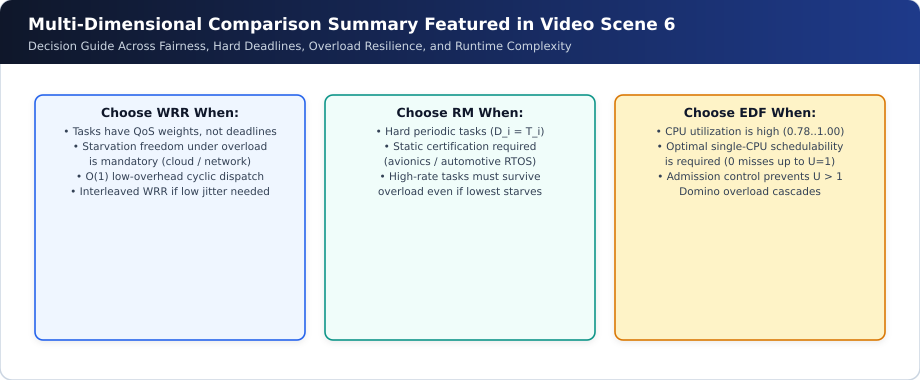
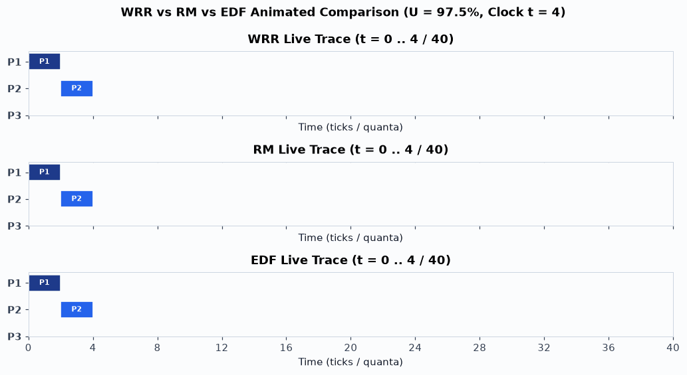

# تمرین ۶ — ویدئو ارائه: WRR vs EDF و RM (>۲ دقیقه)

**۶ scena، استوری‌بورد ۱۵۰ثانیه، دیمو GIF متحرک، کلید‌فریم، متن Erzähl کردن**

- **دوره:** سیستم‌عامل
- **تمرین:** ۶ — بسته ارائه ویدیویی
- **شاخه:** Exercise-6-WRR
- **مدت:** ۱۵۰ ثانیه (۰۲:۳۰) — بیشتر از الزام ۲ دقیقه
- **Scenes:** ۶ scena زمان‌بندی‌شده: معرفی → WRR → EDF → RM → مقایسه → نتیجه

---

## فهرست مطالب

1. معرفی ویدئو
2. آثار
3. نتیجه‌گیری

---

## 1. معرفی ویدئو

بسته ویدئویی ارائه WRR vs EDF و RM با ۶ scena ومدت ۱۵۰ ثانیه (۰۲:۳۰).

- scena ۱: معرفی WRR
- scena ۲: WRR در عمل
- scena ۳: EDF
- scena ۴: RM
- scena ۵: مقایسه
- scena ۶: نتیجه‌گیری

## 2. آثار

*شکل 1 — FIGURE: استوری‌بورد ۶ scena*

*شکل 2 — FIGURE: راهنمای تصمیم‌گیری*

*شکل 3 — FIGURE: انیمیشن WRR vs EDF vs RM*

**جدول 1 — جدول — استوری‌بورد**

| Scena | زمان | محتوا |
| --- | --- | --- |
| ۱ | ۰۰:۰۰–۰۰:۲۵ | معرفی WRR و Ziele |
| ۲ | ۰۰:۲۵–۰۰:۵۰ | WRR در عمل |
| ۳ | ۰۰:۵۰–۰۱:۱۵ | EDF — earliest deadline |
| ۴ | ۰۱:۱۵–۰۱:۴۰ | RM — rate monotonic |
| ۵ | ۰۱:۴۰–۰۲:۰۵ | مقایسه WRR/EDF/RM |
| ۶ | ۰۲:۰۵–۰۲:۳۰ | نتیجه‌گیری و پرسش |

## 3. نتیجه‌گیری

ویدئو بیش از ۲ دقیقه است و تمام موارد course را پوشش می‌دهد.
